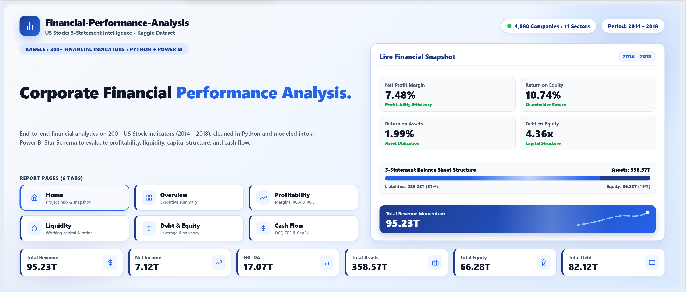
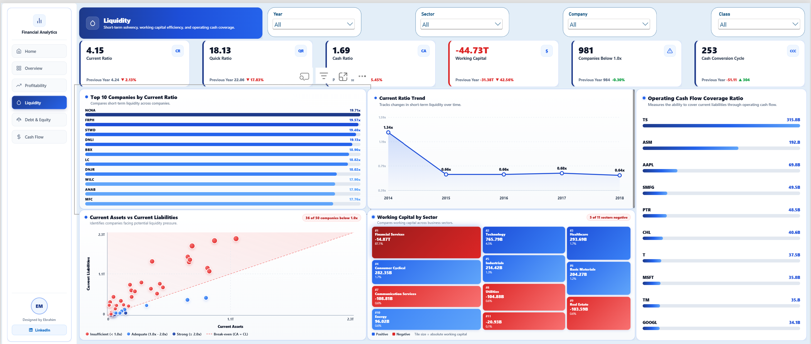

# 📊 Financial-Performance-Analysis

---

An end-to-end corporate financial analytics project (**Financial-Performance-Analysis**) built on **200+ Financial Indicators of US Stocks (2014–2018)** from Kaggle, covering companies across diverse sectors to deliver executive-ready insights across profitability, liquidity, capital structure, and cash flow.

I worked on this dataset end-to-end: data exploration and Python cleaning (`Financial Analyst.ipynb`), Power BI data modeling and DAX engineering, and finally custom HTML/CSS/SVG visuals in an interactive multi-page financial report.

---

## 🛠️ Tech Stack & Tools
- **Data Cleaning & Preparation:** Python (`Financial Analyst.ipynb`, Pandas, NumPy)
- **Data Modeling & Analytics:** Power BI (Star Schema, DAX Measures)
- **Custom Visuals & UI Styling:** HTML / CSS / SVG inside Power BI (HTML Content visual) + a consistent Blue/White corporate theme

---

## 📖 Project Workflow: Data → Modeling → Report

### 1️⃣ Data Exploration & Python Preparation
- Explored the **200+ Financial Indicators of US Stocks** dataset from Kaggle, spanning multi-year financial statements and metrics across companies and sectors.
- Started in **Power BI**, then realized that raw multi-company financial data needs structural preparation first, so cleaning moved to **Python** (`Financial Analyst.ipynb`) before building the BI model.
- Cleaned and standardized financial values, missing entries, and data types so downstream DAX calculations stay accurate.

---

### 2️⃣ Data Modeling & DAX Engineering
- Built a **Star Schema** in Power BI connecting financial facts with dimension tables (`DimYear`, `DimCompany`) to support multi-year analysis, YoY comparisons, margins, ratios, and dynamic filtering (`Year`, `Sector`, `Company`, `Class`).
- Engineered **DAX measures** covering `Total Revenue`, `Net Income`, `EBITDA`, `Total Assets`, `Total Liabilities`, `Total Shareholders Equity`, `Total Debt`, `Operating Cash Flow`, `Free Cash Flow`, `CapEx`, `Revenue Growth`, `Net Income Growth`, `ROE`, `ROA`, `Net Profit Margin`, `Current Ratio`, `Quick Ratio`, `Cash Ratio`, `Working Capital`, and `Debt-to-Equity`.

---

### 3️⃣ Home Page & Report Pages

#### 🏠 Home Page

- Executive landing view (**Financial Analytics — Corporate Performance & 3-Statement Intelligence**) with dataset coverage, report navigation, a **Live Financial Snapshot** (`Net Profit Margin`, `Return on Equity`, `Return on Assets`, `Debt-to-Equity`, balance sheet structure bar, revenue momentum), and a bottom KPI strip (`Total Revenue`, `Net Income`, `EBITDA`, `Total Assets`, `Total Equity`, `Total Debt`).

#### 📈 Overview

- Executive summary with slicers (`Year`, `Sector`, `Company`, `Class`), KPI cards (`Total Revenue`, `Net Income`, `EBITDA`, `Net Profit Margin`, `Return on Assets`, `Total Assets`) with prior-year comparisons, **Revenue Trend Over Time**, **Top Companies by Revenue**, **Top Companies by Net Income**, **Revenue Contribution by Sector**, and **Revenue vs Net Income**.

#### 📊 Profitability

- Earnings quality and return efficiency: KPIs (`Gross Profit`, `Operating Income`, `EBITDA`, `Gross Margin`, `Return on Equity`, `Net Profit Margin`), **Gross Profit vs Operating Income**, **Top Companies by ROE**, **Top Net Income Companies**, **Revenue vs Net Income**, and **Operating Profit Margin by Sector & Year**.

#### 💧 Liquidity

- Short-term solvency and working capital health: KPIs (`Current Ratio`, `Quick Ratio`, `Cash Ratio`, `Working Capital`, `Companies Below 1.0x`, `Cash Conversion Cycle`), **Top Companies by Current Ratio**, **Current Ratio Trend**, **Operating Cash Flow Coverage Ratio**, **Current Assets vs Current Liabilities**, and **Working Capital by Sector**.

#### ⚖️ Debt & Equity

- Leverage, capital structure, and solvency: KPIs (`Total Assets`, `Total Liabilities`, `Total Debt`, `Total Equity`, `Interest Expense`, `Debt-to-Equity`), **Debt-to-Equity Trend**, **Debt vs Shareholders' Equity**, **Top Companies by Total Debt**, **Capital Structure by Sector**, and **Interest Coverage by Company**.

#### 💵 Cash Flow

- Cash generation, capital allocation, and cash conversion: KPIs (`Operating Cash Flow`, `Free Cash Flow`, `Capital Expenditure`, `FCF Margin`, `Revenue Growth`, `Net Income Growth`), **Operating Cash Flow Trend**, **Operating Cash Flow by Company**, **Top Companies by Free Cash Flow**, **Revenue vs Operating Cash Flow Margin**, and **Cash Flow Components**.

---

## 🧩 How the Custom Visuals Work
- Every card and chart is a **DAX measure that returns an HTML/CSS/SVG string**, rendered by Power BI's **HTML Content** visual. Charts (line, bar, column, scatter, treemap, waterfall, donut, heatmap) are drawn from scratch with SVG and CSS.
- Animations and hover tooltips use **pure CSS**, since the visual does not execute JavaScript.
- Cards follow the report filters: they show the selected period versus the previous year, and on "All" they aggregate all years.
- **Limitation:** HTML visuals do not cross-filter other visuals, so interactivity comes from the slicers.

---

## 🔎 Key Findings (All years, 2014–2018)
- **Revenue** totals **95.23T** with **7.12T** net income (**7.48%** net profit margin). Yearly revenue dipped in 2015 (17.4T) and reached **21.5T** in 2018.
- **Cash:** operating cash flow totals **17.32T**; investing outflows (−12.67T) and financing outflows (−1.16T) leave a net cash change of **+3.49T**. Free cash flow (**8.68T**) is about half of operating cash flow.
- **Top net income:** AAPL (246.47B), JPM (118.84B), and WFC (112.47B) lead the company ranking.
- **Sector margins:** Real Estate and Financial Services lead operating margins (around 20%+), while Energy is the only sector with a negative operating margin (−1.8% in 2015).

---

## ⚠️ Data Notes
- **ROE chart:** companies with near-zero equity produce extreme ratios, so the Top 10 ROE chart caps ROE at 150% and excludes negative equity.
- **Financial Services** (banks and insurers) balance sheets are not split into current and non-current items, so liquidity metrics (Current Ratio, Working Capital) should be read per sector, not only in aggregate.
- Ratios are computed as total over total (not averages of company ratios), and YoY changes for percentage KPIs are shown in percentage points where noted.

---

## 💡 التوصيات التنفيذية للبزنس | Business Recommendations

### 1. مراقبة جودة الأرباح وتقوية التحويل النقدي (Earnings Quality & Cash Conversion)
- **الملاحظة:** تتفاوت قدرة الشركات والقطاعات على تحويل الأرباح المحاسبية إلى تدفقات نقدية حرة (`Free Cash Flow`) بسبب التزامات رأس المال العامل (`Working Capital`) والإنفاق الرأسمالي (`CapEx`).
- **التوصية:** ربط تقييم الأداء المالي بمؤشر **FCF Margin** ونسبة تحويل التدفق التشغيلي (`Operating Cash Flow`) بجانب صافي الربح والهوامش، لتمييز الأداء النقدي الحقيقي عن النمو المحاسبي فقط.
- **In short:** evaluate performance through FCF margin and cash conversion alongside net profit, to separate real cash performance from accounting growth.

---

### 2. إدارة رأس المال العامل والالتزامات قصيرة الأجل بحذر (Working Capital & Short-Term Solvency)
- **الملاحظة:** يظهر **Working Capital** بالسالب على المستوى الكلي في صفحة السيولة مع اختلاف واضح بين القطاعات وضغط الالتزامات قصيرة الأجل في بعض القطاعات.
- **التوصية:** قراءة مؤشرات السيولة (`Current Ratio` و `Quick Ratio`) وحجم **Working Capital** على مستوى كل قطاع منفرداً، ومتابعة الشركات التي تقع تحت الحد الأدنى لتفادي أي ضغوط سيولة مفاجئة.
- **In short:** read liquidity ratios per sector and track companies below 1.0x.

---

### 3. ضبط الرافعة المالية وتغطية الفوائد (Leverage & Interest Coverage Discipline)
- **الملاحظة:** تتباين مستويات المديونية (`Total Debt` و `Debt-to-Equity`) وقدرة تغطية مصروفات الفوائد (`Interest Coverage`) بشكل ملحوظ بين الشركات والقطاعات.
- **التوصية:** متابعة نسب الرافعة المالية حسب طبيعة كل قطاع، والتركيز على الشركات ذات المديونية المرتفعة أو انخفاض هامش تغطية الفوائد (`Interest Coverage`) خصوصاً في فترات ارتفاع تكلفة التمويل أو تباطؤ الإيرادات.
- **In short:** monitor leverage by sector and watch highly indebted companies with weak interest coverage.

---

### 4. توجيه الاستثمارات نحو القطاعات ذات العائد والسيولة الأعلى (Capital Allocation & Sector Prioritization)
- **الملاحظة:** تتركز الإيرادات وصافي الأرباح والتدفقات النقدية في شركات وقطاعات محددة بينما تختلف هوامش الربحية و`ROE` و`ROA` عبر القطاعات.
- **التوصية:** استخدام التقرير للمقارنة المعيارية بين القطاعات والشركات بناءً على الجمع بين **كفاءة العائد (`ROE` / `ROA`)**، **قوة التدفق النقدي الحر**، و**اعتدال المديونية** بدلاً من الاعتماد على حجم الإيرادات وحده.
- **In short:** benchmark sectors by combining return efficiency, free cash flow strength, and moderate leverage, not revenue size alone.

---

## ▶️ How to Open the Project
1. Download the dataset from Kaggle: **200+ Financial Indicators of US Stocks (2014–2018)** (add link).
2. Run `Financial Analyst.ipynb` (Python, Pandas, NumPy) to produce the cleaned data.
3. Open the `.pbix` in **Power BI Desktop** and install the **HTML Content** visual from AppSource (the report visuals depend on it).

---

### 👤 Created By:
**Ebrahim Mostafa** — *Junior Data Analyst & BI Analyst* · [LinkedIn](https://www.linkedin.com/in/ebrahim-mostafa-data-analysis/)
