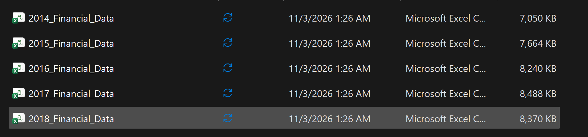
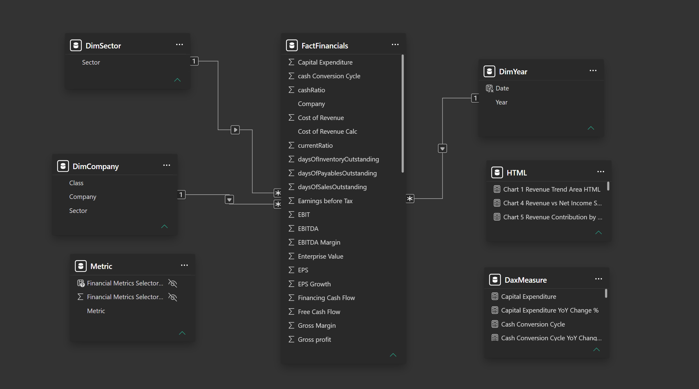
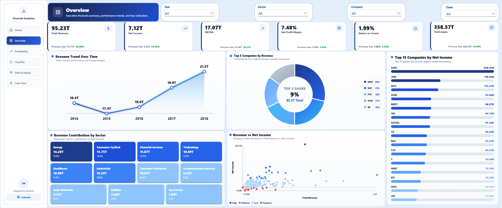
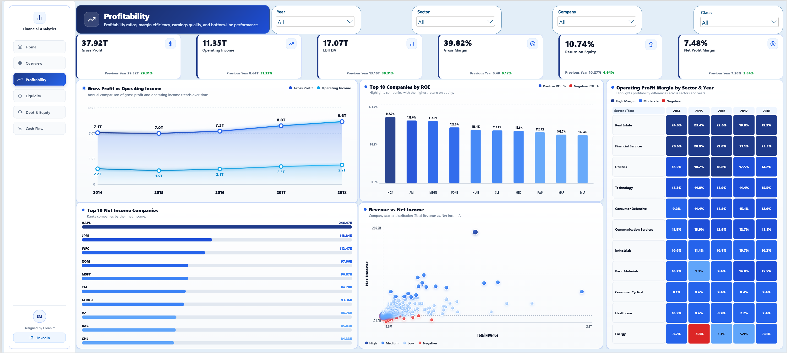

# 📊 Financial Analytics & 3-Statement Intelligence Hub

---

An end-to-end corporate financial analytics project built on **200+ Financial Indicators of US Stocks (2014–2018)** from Kaggle, covering **4,980 companies** across **11 sectors** to deliver executive-ready insights across profitability, liquidity, capital structure, and cash flow[cite: 1, 2, 3, 4, 5, 6].

I worked on this dataset end-to-end—starting from data exploration and Python cleaning (`Financial Analyst.ipynb`), moving into Power BI data modeling and DAX engineering, and finishing with custom HTML/CSS/SVG visuals and interactive multi-page financial reporting[cite: 1, 2, 3, 4, 5, 6, 9, 10].

---

## 🛠️ Tech Stack & Tools
- **Data Cleaning & Preparation:** Python (`Financial Analyst.ipynb`, Pandas, NumPy)[cite: 9, 10]
- **Data Modeling & Analytics:** Power BI (Star Schema, DAX Measures)[cite: 10]
- **Custom Visuals & UI Styling:** HTML / CSS / SVG inside Power BI + Consistent Blue/White Corporate Theme[cite: 1]

---

## 📖 Project Workflow: Data → Modeling → Home Page & Report

### 1️⃣ Data Exploration & Why Data Chooses the Tool
- Explored the **200+ Financial Indicators of US Stocks (2014–2018)** dataset from Kaggle, spanning multi-year financial statements and metrics across **4,980 companies** and **11 sectors**[cite: 1].
- Started initially with **Power BI**, then realized that raw multi-company financial data needs proper structural preparation first—so **the data chose the tool**, moving data cleaning and preparation to **Python** (`Financial Analyst.ipynb`) before building the BI model[cite: 9, 10].
- Cleaned and standardized financial values, missing entries, data types, and time periods (`2014–2018`) in Python so downstream modeling and DAX calculations stay accurate and reliable[cite: 1, 9, 10].

[cite: 10]

---

### 2️⃣ Data Modeling & DAX Engineering
- After cleaning the data in Python, built the **Data Model** in Power BI connecting financial facts with dimension tables (`DimYear`, `DimCompany`) to support multi-year analysis, YoY comparisons, margins, ratios, and dynamic filtering (`Year`, `Sector`, `Company`, `Class`)[cite: 1, 2, 3, 4, 5, 6, 10].
- Engineered **DAX measures** covering `Total Revenue`, `Net Income`, `EBITDA`, `Total Assets`, `Total Liabilities`, `Total Shareholders Equity`, `Total Debt`, `Operating Cash Flow`, `Free Cash Flow`, `CapEx`, `Revenue Growth`, `Net Income Growth`, `ROE`, `ROA`, `Net Profit Margin`, `Current Ratio`, `Quick Ratio`, `Cash Ratio`, `Working Capital`, and `Debt-to-Equity`[cite: 1, 2, 3, 4, 5, 6].
- Built custom **HTML/CSS/SVG visuals** inside Power BI to deliver executive cards, dynamic formatting, hover tooltips, and a unified blue-and-white design across all pages[cite: 1, 2, 3, 4, 5, 6].

[cite: 10]

---

### 3️⃣ Home Page & Report Pages

#### 🏠 Home Page
[cite: 10]
- Executive landing view (**Financial Analytics — Corporate Performance & 3-Statement Intelligence**) displaying dataset coverage (`4,980 Companies • 11 Sectors`, `Period: 2014 – 2018`), report section navigation, a **Live Financial Snapshot** (`Net Profit Margin`, `Return on Equity`, `Return on Assets`, `Debt-to-Equity`, balance sheet structure bar, and revenue momentum), and a 6-KPI bottom strip (`Total Revenue`, `Net Income`, `EBITDA`, `Total Assets`, `Total Equity`, `Total Debt`)[cite: 1].

#### 📈 Overview
[cite: 10]
- Executive summary with top slicers (`Year`, `Sector`, `Company`, `Class`), 6 top KPI cards (`Total Revenue`, `Net Income`, `EBITDA`, `Net Profit Margin`, `Return on Assets`, `Total Assets`) with prior-year comparisons, **Revenue Trend Over Time**, **Top 5 Companies by Revenue**, **Top 15 Companies by Net Income**, **Revenue Contribution by Sector**, and **Revenue vs Net Income**[cite: 2].

#### 📊 Profitability
[cite: 10]
- Focuses on earnings quality and return efficiency through 6 top KPIs (`Gross Profit`, `Operating Income`, `EBITDA`, `Gross Margin`, `Return on Equity`, `Net Profit Margin`), **Gross Profit vs Operating Income**, **Top 10 Companies by ROE**, **Top 10 Net Income Companies**, **Revenue vs Net Income**, and **Operating Profit Margin by Sector & Year**[cite: 3].

#### 💧 Liquidity
[cite: 10]
- Evaluates short-term solvency and working capital health via 6 KPIs (`Current Ratio`, `Quick Ratio`, `Cash Ratio`, `Working Capital`, `Companies Below 1.0x`, `Cash Conversion Cycle`), **Top 10 Companies by Current Ratio**, **Current Ratio Trend**, **Operating Cash Flow Coverage Ratio**, **Current Assets vs Current Liabilities**, and **Working Capital by Sector**[cite: 4].

#### ⚖️ Debt & Equity
[cite: 10]
- Analyzes leverage, capital structure, and solvency through 6 KPIs (`Total Assets`, `Total Liabilities`, `Total Debt`, `Total Equity`, `Interest Expense`, `Debt-to-Equity`), **Debt-to-Equity Trend**, **Debt vs Shareholders' Equity**, **Top 10 Companies by Total Debt**, **Capital Structure by Sector**, and **Interest Coverage by Company**[cite: 5].

#### 💵 Cash Flow
[cite: 10]
- Tracks cash generation, capital allocation, and cash conversion via 6 KPIs (`Operating Cash Flow`, `Free Cash Flow`, `Capital Expenditure`, `FCF Margin`, `Revenue Growth`, `Net Income Growth`), **Operating Cash Flow Trend**, **Operating Cash Flow by Company**, **Top 10 Companies by Free Cash Flow**, **Revenue vs Operating Cash Flow Margin**, and **Cash Flow Components**[cite: 6].

---

## 💡 التوصيات التنفيذية للبزنس | Business Recommendations

### 1. مراقبة جودة الأرباح وتقوية التحويل النقدي (Earnings Quality & Cash Conversion)
- **الملاحظة:** رغم تسجيل نمو في الإيرادات وصافي الدخل خلال الفترة (`2014–2018`)، تتفاوت قدرة الشركات والقطاعات على تحويل الأرباح إلى تدفقات نقدية حرة (`Free Cash Flow`) بسبب التزامات رأس المال العامل (`Working Capital`) والإنفاق الرأسمالي (`CapEx`)[cite: 1, 2, 6].
- **التوصية:** ربط تقييم الأداء المالي بمؤشر **FCF Margin** ونسبة تحويل التدفق التشغيلي (`Operating Cash Flow`) بجانب صافي الربح والهوامش، لتمييز الأداء النقدي الحقيقي عن النمو المحاسبي فقط[cite: 3, 6].

---

### 2. إدارة رأس المال العامل والالتزامات قصيرة الأجل بحذر (Working Capital & Short-Term Solvency)
- **الملاحظة:** يظهر إجمالي **Working Capital** بالسالب على المستوى الكلي في صفحة السيولة مع اختلاف واضح بين القطاعات وضغط الالتزامات قصيرة الأجل في بعض القطاعات[cite: 4].
- **التوصية:** قراءة مؤشرات السيولة (`Current Ratio` و `Quick Ratio`) وحجم **Working Capital** على مستوى كل قطاع منفرداً، ومتابعة الشركات التي تقع تحت حد `1.0x` لتفادي أي ضغوط سيولة مفاجئة[cite: 4].

---

### 3. ضبط الرافعة المالية وتغطية الفوائد (Leverage & Interest Coverage Discipline)
- **الملاحظة:** تتباين مستويات المديونية (`Total Debt` و `Debt-to-Equity`) وقدرة تغطية مصروفات الفوائد (`Interest Coverage`) بشكل ملحوظ بين الشركات والقطاعات[cite: 5].
- **التوصية:** متابعة نسب الرافعة المالية حسب طبيعة كل قطاع، والتركيز على الشركات ذات المديونية المرتفعة أو انخفاض هامش تغطية الفوائد (`Interest Coverage`) خصوصاً في فترات ارتفاع تكلفة التمويل أو تباطؤ الإيرادات[cite: 5].

---

### 4. توجيه الاستثمارات نحو القطاعات ذات العائد والسيولة الأعلى (Capital Allocation & Sector Prioritization)
- **الملاحظة:** تتركز الإيرادات وصافي الأرباح والتدفقات النقدية في شركات وقطاعات محددة بينما تختلف هوامش الربحية و`ROE` و`ROA` عبر القطاعات الـ 11[cite: 1, 2, 3, 6].
- **التوصية:** استخدام التقرير للمقارنة المعيارية بين القطاعات والشركات بناءً على الجمع بين **كفاءة العائد (`ROE` / `ROA`)**، **قوة التدفق النقدي الحر**، و**اعتدال المديونية** بدلاً من الاعتماد على حجم الإيرادات وحده[cite: 1, 3, 5, 6].

---

### 👤 Created By:
**إبراهيم مصطفى** — *Junior Data Analyst & BI Analyst*
